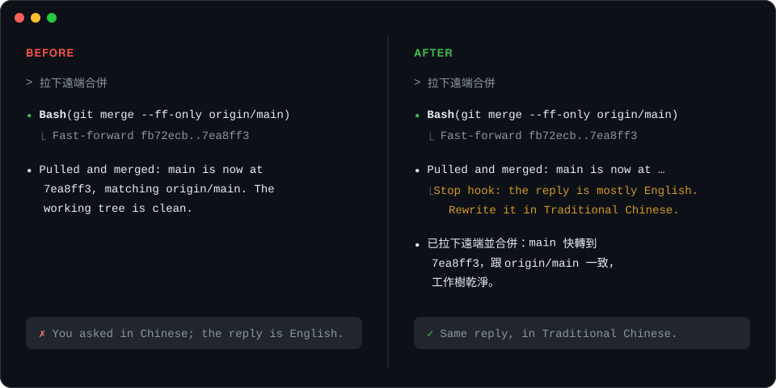

# reply-language

<p align="center">
  <strong>Replies stay in Traditional Chinese.</strong><br>
  A Claude Code Stop hook that sends a reply written mostly in English back to Claude, to rewrite in Traditional Chinese with Taiwan terminology.
</p>

<p align="center">
  <a href="CHANGELOG.md"></a>
  <a href="LICENSE"></a>
  <a href="https://code.claude.com/docs"></a>
  <a href="hooks/hooks.json"></a>
  <a href="hooks/reply-language-check.test.mjs"></a>
</p>

<p align="center">
  <a href="#features">Features</a> ·
  <a href="#install">Install</a> ·
  <a href="#usage">Usage</a> ·
  <a href="#limitations">Limitations</a> ·
  <a href="#development">Development</a> ·
  <a href="CONTRIBUTING.md">Contributing</a> ·
  <a href="CHANGELOG.md">Changelog</a>
</p>



*Illustration of a session before and after.*

Instructions such as "reply in Traditional Chinese" in `CLAUDE.md` work most of the time, but after a long run of tool calls Claude can slip back into English. reply-language checks each reply when Claude ends its turn. When the reply is mostly English, Claude gets it back once with the instruction to rewrite the same reply in Traditional Chinese, keeping code, commands, paths and identifiers as they are.

## Features

- **Checks the final reply only:** The hook reads the transcript back to the last user-role entry: a prompt, a tool result or a subagent hand-back. English status lines written between tool calls earlier in the turn do not count.
- **Technical terms are free:** Code blocks, inline code, URLs and paths are removed before counting, so a Chinese reply full of `git` commands and file names passes.
- **One rewrite per reply:** When Claude is already rewriting because of this hook, the reply is not checked again, so a turn can never loop.
- **Short replies pass:** A reply with fewer than 40 letters and Han characters is never sent back.
- **Nothing to configure:** One Node.js script with no dependencies, registered as a Stop hook by the plugin.

| Final reply | Result |
| --- | --- |
| Mostly Chinese, with commands in backticks or code blocks | Passes |
| Mostly Chinese, after English status lines earlier in the turn | Passes |
| Mostly English, at least 40 letters and Han characters | Sent back once to rewrite |
| Shorter than 40 letters and Han characters | Passes |

## Install

In a Claude Code **terminal** session, run:

```
/plugin install reply-language --marketplace AnnihilationWizard/reply-language
```

1. Answer `y` to add the `github:AnnihilationWizard/reply-language` marketplace.
2. Choose a scope. The **user** scope runs the hook in every session.
3. Claude Code confirms `Plugin is now active.` No restart is needed.

It is also listed in the [AnnihilationWizard/claude-hooks](https://github.com/AnnihilationWizard/claude-hooks) marketplace as `reply-language@claude-hooks`.

> [!TIP]
> If the same script is also registered as a Stop hook in `~/.claude/settings.json`, remove that entry after installing, or each reply is checked twice.

To update later, run `claude plugin update`, then `/reload-plugins`.

<details>
<summary>Run from a local clone instead</summary>

```bash
git clone https://github.com/AnnihilationWizard/reply-language.git
claude --plugin-dir ./reply-language
```

To load a clone in every session, add it to the `env` block of `~/.claude/settings.json`:

```json
{
  "env": { "CLAUDE_CODE_PLUGIN_DIRS": "/path/to/reply-language" }
}
```

</details>

## Usage

Once installed, there is nothing to configure. When a reply is mostly English, Claude reads:

```text
The reply to the user is mostly in English. Rewrite the same reply in Traditional Chinese
with Taiwan terminology, keeping code, commands, paths and identifiers as they are.
```

### What counts as English

After code blocks, inline code, `http` and `https` URLs, and paths with at least one `/` are removed, the hook counts Latin letters and Han characters in what is left. The reply is English when the two together reach 40 and there are more than twice as many Latin letters as Han characters.

## Limitations

- Plugins do not load in Claude Code on the web (cloud sessions). To use the hook there, commit a copy of the script to the repository and register it in that repository's `.claude/settings.json`.
- Only the language mix is checked, not the terminology. A reply in Simplified Chinese, or with mainland China terms, passes.
- A reply that is mostly English prose outside code formatting, such as a quoted error message, is sent back once. Put such text in a code block.
- The thresholds are fixed in the script.

## Development

```bash
claude plugin validate --strict .   # manifest, marketplace file and hooks
node --test hooks/                   # runs the hook on sample transcripts
```

Run `claude --plugin-dir .` to try changes. A change reaches installed copies only when `version` in `.claude-plugin/plugin.json` goes up.

## Project Structure

```text
.claude-plugin/   plugin.json manifest and marketplace.json
hooks/            hooks.json, the Stop hook script and its tests
docs/images/      README illustration
```

## Contributing

Bug reports and ideas are welcome. Read [CONTRIBUTING.md](CONTRIBUTING.md) before opening an [issue](https://github.com/AnnihilationWizard/reply-language/issues) or pull request, and follow [SECURITY.md](SECURITY.md) for security reports.

## License

[MIT License](LICENSE). Copyright © 2026 [AnnihilationWizard](https://github.com/AnnihilationWizard).
